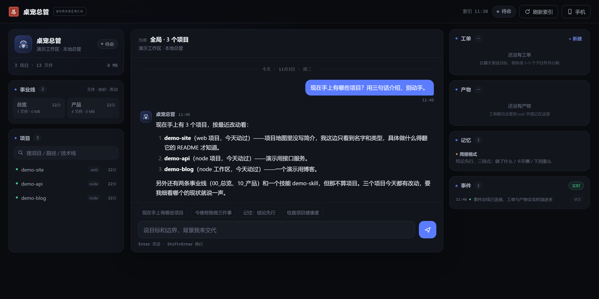
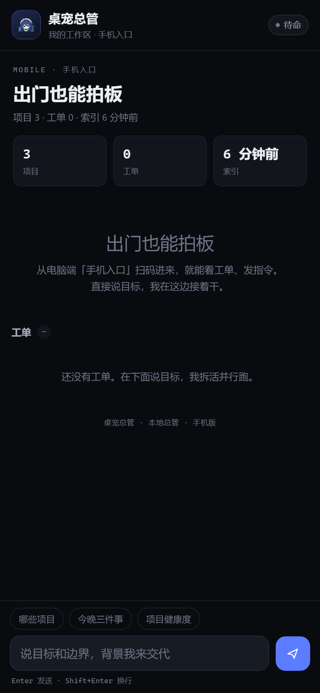

# 桌宠总管 · DeskPet Steward

> **一个 personal agent 的桌宠版。** 桌面上趴着一只小鲸，替你看状态；屏幕后面跑着一个本地总管，替你扫项目、拆活、派工单、记事。


<p align="center">
  <b>本地优先 · 数据不出机器 · 密钥永不进仓库</b><br>
  <sub>Node 22.5+ · Electron · SQLite · DeepSeek · MIT</sub>
</p>

## 它是什么

桌宠总管是两件东西，用一个本地 HTTP 服务连起来：

| | 桌宠（`pet/`） | 总管（`server/` + `web/`） |
| --- | --- | --- |
| 形态 | Electron 桌面宠物，透明无边框窗 | Node HTTP 服务 + 原生 JS 工作台，不打包 |
| 职责 | 常驻角落、跟状态换表情、点开就聊 | 扫工作区、聊天、拆活派单、记长期记忆、手机看板 |
| 依赖 | Electron（首次 `npm install` 会下运行时） | Node 内置能力，零第三方依赖 |
| 数据 | 不存业务数据，状态全靠轮询和 SSE（只有 Electron 缓存和调试日志） | SQLite（`data/steward.db`）+ 产物目录 `out/` |

两边是松耦合的：关掉桌宠，工作台照常用；不起服务，桌宠只会显示一条「未上线」。桥接协议见 `docs/PET-INTEGRATION.md`。



<p align="center"><sub>工作台：左边项目地图，中间对话，右边工单 / 产物 / 记忆 / 事件流。图里是仓库自带的演示数据。</sub></p>

## 30 秒跑起来

前置：**Node 22.5 或更高（推荐 Node 24）**。服务端用了内置的 `node:sqlite`（22.5 才引入），早期 22.x / 23.x 启动时要加 `--experimental-sqlite`；用 Node 24 不用加。桌宠另外需要 Electron。

```bash
git clone https://github.com/qin-zhi-peng/deskpet-steward.git
cd deskpet-steward

# 1) 复制配置，改成你自己的目录
cp config.example.json config.json        # Windows: copy config.example.json config.json
#    编辑 config.json，重点改 roots（下面有逐字段说明）

# 2) 放 key（只在 .env 里，永不进仓库）
cp .env.example .env                      # Windows: copy .env.example .env
#    .env 里只写一行：DEEPSEEK_API_KEY=sk-xxxxxxxx

# 3) 起总管。根目录没有依赖，不用 npm install
node server/index.mjs
# → http://127.0.0.1:8795
```

开桌宠（另开一个终端）：

```bash
cd pet
npm install     # 首次会下 Electron 运行时，约 150 MB
npm start       # 小鲸出现在屏幕右下角
```

Windows 一条命令起总管（PowerShell）：

```powershell
powershell -NoProfile -ExecutionPolicy Bypass -File scripts\start.ps1
```

只想看界面、不想配 key：浏览器打开 `http://127.0.0.1:8795/?mock=1`，或直接双击 `web/index.html`，会加载 `web/lib/mock.js` 里的演示数据。

## 它能干什么

**项目地图。** 启动时扫一遍 `config.json` 里配的几个根目录，把每个项目的路径、类型、文件数、体积、最近改动、README 首段收进索引。工作台左栏就是这张地图，按事业线分组，可以按名字、路径、技术栈搜。点某个项目就进入项目层，后面的提问都围着它转。

**聊天。** 流式输出，能调工具：查项目、读文件、按关键词搜文件、列技能、派工单、写记忆。它先看项目地图再答，不会凭空编项目名。说一句「现在手上有哪些项目」，回来的是一份带路径和最近改动的清单。

**工单。** 你说目标，它先拆成 1–5 个子任务（简单的事就拆 1 个，不硬凑），最多 3 路并行，每个子任务独立上下文。关键是**必须真落盘**：子任务要么用 `write_file` 把文件写进你的项目目录，要么用 `write_artifact` 在 `out/<工单号>/` 留一份产物；两头都没写成，这张子任务就记失败，工单状态是 `failed` 或 `partial`，不会假装完成。

**长期记忆。** 说「记住：周报用三段式」，它调 `remember` 写进 SQLite，置顶的条目每次对话都会注入系统提示词。也可以在右栏手动置顶、删除。

**手机看板。** 把 `server.host` 改成 `0.0.0.0`，工作台右上角「手机」给出局域网地址和二维码（带访问令牌）。手机打开是单列的聊天加工单页，在同一个局域网里也能看进度、拍板。

<p align="center"></p>

**桌宠。** 单击会有反应（连点变生气、再点变委屈），按住拖动、松手吸附屏幕边缘，闲置 45 秒打瞌睡；右键菜单和系统托盘里能开聊天、打开工作台、把窗口藏起来。工单完成时它冒泡提醒，缺 key 或没连上服务时是哭脸。


## 配置

`config.json` 放在仓库根目录（确认已加入 `.gitignore`），从 `config.example.json` 复制。优先级：**环境变量 > config.json > 内置默认值**。

| 字段 | 默认 | 说明 |
| --- | --- | --- |
| `roots[].key` | — | 扫描根的标识，`list_projects` 的 `root` 参数用它过滤 |
| `roots[].kind` | `projects` | `career`：一级目录当事业线、其下文件数 ≥ 2 的二级目录当项目；`projects`：一级目录直接当项目；`notes`：只收 `.md`；`skills`：读每个子目录 `SKILL.md` 的 description |
| `roots[].name` | 同 `key` | 显示名，出现在项目卡片的来源里 |
| `roots[].path` | — | 绝对路径，支持 `~` 和 `~/xxx` |
| `roots[].depth` | career/projects 为 2，notes/skills 为 1 | 扫描深度；超过深度不往下走 |
| `server.port` | `8795` | 监听端口 |
| `server.host` | `127.0.0.1` | 只本机访问；手机看板要改成 `0.0.0.0` |
| `agent.name` | `桌宠总管` | 名字，注入提示词、显示在工牌和桌宠上 |
| `agent.no` | `No.001` | 工牌编号，纯展示 |
| `agent.tagline` | `我的工作区 · 本地总管` | 工牌副标题 |
| `model.name` | `deepseek-chat` | 模型名 |
| `model.base` | 空 | 自定义 OpenAI 兼容网关；留空则直连 `https://api.deepseek.com` |
| `model.proxyBase` | `http://127.0.0.1:8787` | 仅当 key 形如 `cx-` / `wb-` / `dc-` 时走这个本地代理 |
| `readOnly[]` | 空 | 额外允许读取的目录（不参与项目地图，只给 `read_file` / `search_files` 用） |
| `writeRoots[]` | 取 `kind` 为 `projects` / `notes` 的根 | 工单可写白名单，没配就按上面的规则推导 |

环境变量可以覆盖同名项：`STEWARD_PORT`、`STEWARD_HOST`、`STEWARD_MODEL`、`STEWARD_NAME`、`STEWARD_TAGLINE`、`STEWARD_CONFIG`（配置文件路径）、`STEWARD_ENV_FILE`、`STEWARD_API_BASE`、`STEWARD_PROXY_BASE`、`STEWARD_WRITE_ROOTS`（分号分隔，优先级高于 config）。

扫描时会跳过 `node_modules`、`.git`、`dist`、`build`、`out`、`tmp`、`logs` 等目录；视频、压缩包、字体、Office 文档等二进制扩展名仍计入文件数和体积，但不读内容、不进技术栈统计；单个目录最多 25000 个文件或 5 秒，到点截断。

## 密钥怎么放

只有一条路：

```bash
# .env（仓库根目录；确认已加入 .gitignore，永远不要提交）
DEEPSEEK_API_KEY=sk-xxxxxxxx
```

- 读取顺序：`STEWARD_API_KEY` → `DEEPSEEK_API_KEY`；真实环境变量优先于 `.env`，方便 CI 或临时覆盖。
- 不读任何其它软件的配置文件，不落盘、不回显；`GET /api/health` 只返回 `hasKey: true / false`。
- 仓库里永远只有占位符。提交前跑一遍自检：`npm run check`（扫 key、口令、本机私有路径、联系方式），CI 里也会跑同一份脚本。
- 万一 key 进过版本库：先去控制台吊销重发，再改 `.env`；只删文件不够，历史里还在。

更多边界（读写白名单、备份、局域网暴露面）见 `docs/SECURITY.md`。

## 目录结构

```text
deskpet-steward/
├── server/                 总管服务（零依赖）
│   ├── index.mjs           HTTP 路由 + SSE 事件总线 + 手机入口
│   ├── agent.mjs           人格、工具、对话循环、工单引擎
│   ├── scanner.mjs         项目地图扫描
│   ├── deepseek.mjs        模型调用（流式 / function calling / 路由降级）
│   ├── store.mjs           SQLite 存储
│   ├── config.mjs          配置与环境变量
│   └── util.mjs            小工具
├── web/                    工作台（原生 JS，无构建）
│   ├── index.html / app.js / app.css
│   ├── mobile.html / mobile.js / mobile.css
│   └── lib/                md.js（Markdown）、api.js（请求）、mock.js（演示数据）
├── pet/                    桌宠（Electron）
│   ├── main.js / preload.js / pet.html
│   └── assets/             立绘、头部贴片、托盘图标
├── integrations/pet-bridge/
│   ├── pet-client.cjs      桌宠接入客户端（零依赖，含 SSE 解析）
│   └── demo.mjs            自检与演示
├── scripts/                启停、自检脚本
├── assets/                 品牌、图标、字体
├── docs/                   规格、接口、接入、安全
├── data/                   SQLite、索引缓存、手机令牌（运行时生成，勿提交）
└── out/                    工单产物与覆盖备份（运行时生成，勿提交）
```

## 安全边界

- **读**：只允许 `roots` 里的目录和 `readOnly` 追加的目录；路径先解析成绝对路径再判断前缀，跳不出去。
- **写**：只允许 `writeRoots` 下的文本文件（`.md` `.txt` `.json` `.yml` `.js` `.ts` `.py` `.css` `.html` `.svg` 等），单个文件 ≤ 200 KB；覆盖已存在的文件必须显式带 `overwrite: true`，覆盖前自动备份到 `out/_backup/<时间戳>/`。
- **删**：模型没有删除、移动、重命名文件的工具。它做不了，也就不会误删。
- **对外动作**：发布、群发、花钱、注册登录这类，系统提示词要求先问；它自己拍板只限技术性和设计性的事。
- **密钥**：只从环境变量和 `.env` 来，日志里只记 token 用量，不记 key。
- **局域网**：非回环地址访问 `/api/*` 和 `/m` 必须带手机令牌；令牌首次用到时随机生成，存在 SQLite 的 `meta` 表里。

## 常见问题

**聊天直接报错，提示缺 key。** 确认 `.env` 在仓库根目录、变量名是 `DEEPSEEK_API_KEY`、值没有多余空格和引号。改完要重启服务（`.env` 只在启动时读一次）。

**报 401 / Authentication Fails。** key 无效或过期，去控制台重发一个。另一种常见情况是 key 形态和端点不匹配：`sk-` 开头直连官网，`cx-` / `wb-` / `dc-` 是本地代理令牌；配错了会自动降级一次，两条都不通就报 401。

**端口被占用（`EADDRINUSE`）。** 换一个：`STEWARD_PORT=8800 node server/index.mjs`，或在 `config.json` 里改 `server.port`。

**桌宠点不到、拖不动。** 右键托盘图标 → 「修复点不到（恢复交互）」，它会把拖拽状态和窗口尺寸一起复位。高 DPI 下如果窗口越拖越大，也是同一个菜单项解决。

**桌宠启动就退，报 `Cannot read properties of undefined (reading 'on')`。** 环境里带着 `ELECTRON_RUN_AS_NODE=1`，Electron 退化成了纯 Node。启动前清掉这个变量（PowerShell：`Remove-Item Env:\ELECTRON_RUN_AS_NODE`）。

**手机扫码打不开。** 三件事依次查：`server.host` 是不是 `0.0.0.0`；手机和电脑在不在同一局域网；系统防火墙有没有放行这个端口。另外二维码是调本机 `python` 的 `qrcode` 包现生成的，没装 python 或没装这个包时二维码接口会报错，其余功能不受影响（照着 `/api/phone` 返回的 url 手输也行）。

**工单显示失败，但我看它明明跑了。** 这是故意的：子任务没有真的写出文件，就算失败。看 `GET /api/tasks/:id` 里每个子任务的 `error`，通常是路径不在可写白名单，或者模型没调写文件工具。

## License

本项目以 MIT 许可证发布。字体 `LiuJianMaoCao` 单独遵循 SIL Open Font License 1.1；分发时请把字体许可证全文随 `assets/fonts/` 一起提供。
